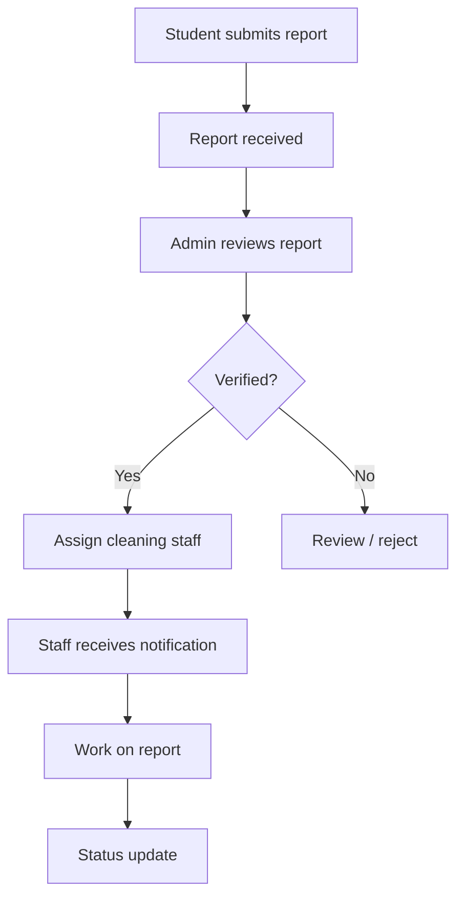

# CAMPuVISE

> A campus waste-management and reporting system designed to streamline waste reporting, verification, assignment and status tracking within a campus.

CAMPuVISE is a campus-oriented waste-management platform that connects report submission with administrative verification, staff assignment and notification workflows. The project aims to make campus waste-management requests easier to submit, manage and track through a centralized system.

---

## Overview

CAMPuVISE is being developed to improve the way waste-related issues are reported and handled within a campus environment.

Instead of relying on informal communication, the system is designed around a structured workflow in which reports can be submitted, reviewed, assigned and tracked by the relevant users.

## Features

- **Report Submission** — Submit campus waste-management reports.
- **Report Verification** — Administrative review and verification of submitted reports.
- **Staff Assignment** — Assign verified reports to the appropriate cleaning staff.
- **Status Tracking** — Track report progress through the management workflow.
- **Role-Based Notifications** — Deliver relevant notifications to students, administrators and cleaning staff.
- **Backend API** — Frontend-backend communication through an API.
- **Data Management** — Backend handling of report data.

## Workflow



## Architecture

CAMPuVISE is developed using a separate frontend and backend architecture.

| Component | Description |
|---|---|
| Frontend | User interface and interaction |
| Backend | C++ server and API handling |
| API | Communication between the frontend and backend |
| Data storage | Backend report-data handling |

## Technology Stack

- **Frontend:** HTML, CSS, JavaScript
- **Backend:** C++
- **HTTP/API:** C++ HTTP server with `cpp-httplib`
- **Development:** Git and GitHub

## Project Structure

```text
CAMPuVISE/
├── frontend/
│   └── User interface files
├── backend/
│   ├── server.cpp
│   ├── httplib.h
│   └── images.h
└── README.md
```

*The directory layout above is illustrative and may not represent the exact current repository structure.*

## Development Status

CAMPuVISE is currently under active development.

The current development focus includes:

- Frontend and backend integration
- Report submission and retrieval
- Verification and assignment workflows
- Role-specific notification logic
- Testing and debugging the API
- Improving the overall user experience

The project is currently a self-hosted development/demo project and is not yet intended as a production deployment.

## Goals

- Simplify campus waste reporting.
- Improve communication between administrators and cleaning staff.
- Make submitted reports easier to track.
- Reduce confusion around report assignments and notifications.
- Build a maintainable and extensible system.

## Contributors

Developed as a collaborative student project.

## License

License information has not yet been specified.
